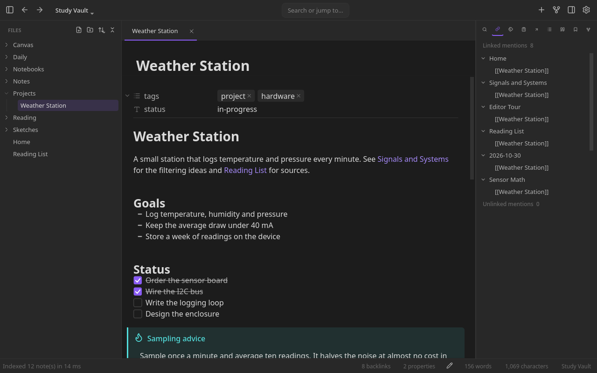

# Notolith

Public beta (0.1.0-beta.1): expect bugs, and back up your vault.

A Markdown note app for developers, for Linux. C++20 and Qt 6 Widgets: no
Electron and no embedded browser. Raw HTML is laid out by litehtml, and the app
runs no JavaScript (a published site includes a small search script).



(Code name noteAppC: it remains in the source targets, the C++ namespace and some
internal identifiers, not in installed paths or in your vault. The binary is
`notolith` and the app id is `io.github.jernejmarcic.Notolith`.)

## Features

- **Obsidian vaults** - opens and works with Obsidian vaults: links and their
  resolution order, embeds, properties, callouts, search syntax and the
  `.obsidian` settings are read as they are. Obsidian themes are read for their
  colours only; fonts, sizes and layout are ignored.
- **Vault** - open any folder of Markdown files, with a file tree and
  byte-exact atomic saves (CRLF and BOM preserved). File recovery keeps
  snapshots with a diff. A note changed on disk (sync, another editor, a link
  update) shows the change in every tab; if you were editing it, your edits
  win and the other version goes to file recovery. A note moved or renamed
  outside the app is followed, caret and unsaved edits kept.
- **Index** - SQLite with FTS5, parallel cold build, incremental rescan
  and link resolution. 20 000 notes cold-index in about 1 s on a Ryzen 9 9900X.
- **Editor** - one engine, three modes: live preview, source and reading.
  Viewport-only layout, incremental edits, parsing off the UI thread; 0.2 ms
  per keystroke on a 200 kB note, on the same machine.
- **Rendered Markdown** - element-by-element syntax reveal, callouts, tables,
  maths, embeds of notes, images, PDFs, audio and video, editable properties,
  `query` blocks, raw HTML (litehtml), Mermaid, PlantUML, TikZ and Graphviz
  diagrams, and syntax-highlighted code.
- **Vim mode** - optional: normal, insert and visual modes, counts, operators
  and motions, `.`, `/` search, `:w` and `:q`.
- **Workspace** - tabs and nested splits, each tab with its own history; the
  layout comes back with the vault, and named layouts can be saved and loaded.
- **Core plugins** - search with a query grammar, backlinks and unlinked
  mentions, outgoing links, tags, outline, bookmarks, daily notes, templates,
  page preview, PDF export, pandoc export and import, hotkeys, a command
  palette (Ctrl+P), and a right-click menu with a web search.
- **Modules** - spellcheck, graph view (global and local), canvas (JSON
  Canvas), bases (`.base` views), a PDF viewer with annotation, image
  annotation, code blocks run
  through a Jupyter kernel, Git-backed note history, and static-site
  publishing. Each can be switched off at build time.
- **EPUB reader** - opens `.epub` books (EPUB 2 and 3) with a table of
  contents, find in book, scrolling or paged reading, and highlights kept in a
  note beside the book. Needs libarchive and litehtml at build time
  (`NOTEAPPC_WITH_EPUB`, on by default).
- **Plugins (preview)** - out-of-process plugins, sandboxed with bubblewrap.
  The plugin format is young and there are no third-party plugins yet.
- **Themes** - dark by default, a documented set of colour tokens,
  custom colour schemes, and per-kind formatting colours (headings, bold,
  links, ...; display only, nothing is written to a note).
- **Touch** - momentum scrolling and long-press selection; sidebars fold on a
  narrow window.

Sync, note sharing and encrypted notes are previews and are off by default:
they are built only with their CMake options (`NOTEAPPC_WITH_SYNC`,
`NOTEAPPC_WITH_SHARE`, `NOTEAPPC_WITH_ENCRYPTION`; see `docs/OFFLINE.md`). Their
cryptography has not been independently audited.

## Network and privacy

The default build makes no network connections: nothing in it opens an
internet socket, and `docs/OFFLINE.md` has the evidence and the list of options
that bring networking back. Remote references (a note that points at a URL) are
off by default. The right-click "Search the web" item hands a search URL
(DuckDuckGo by default) to your browser; the browser sends the query, not the
app. Code blocks, kernels, diagrams, TeX, pandoc and plugins run
only inside a bubblewrap sandbox with no network (a plugin gets the network
only in a build with `NOTEAPPC_WITH_NETWORK`, and only if you grant it);
`docs/NOTEBOOKS.md#sandbox` has the details.

## Install

### Arch Linux and CachyOS

Arch (the PKGBUILD) is the supported package.

```sh
git clone https://github.com/jernejmarcic/Notolith
cd Notolith/packaging/arch
makepkg -si
```

This builds, runs the tests and installs two packages together: `notolith`
and `notolith-pdfview`. `makepkg -si
--nocheck` skips the tests, which build the whole tree a second time. The first
build needs network access to fetch its sources (see the header of
`packaging/arch/PKGBUILD`); the installed app uses none.

Update: `git pull`, then `makepkg -sif` in `packaging/arch`.

Uninstall:

```sh
sudo pacman -Rns notolith notolith-pdfview
```

### Other Linux: build from source

Needs Qt 6.7 or newer, a C++20 compiler, CMake 3.28 or newer, Ninja and git.
The package names below are Arch's.

- **Always:** `qt6-base` `qt6-svg` `cmake` `ninja` `git` `python3`
  `pkgconf`, and a C++20 compiler. `python3` runs at configure time. `pkgconf` finds most of the optional libraries: without it
  they are all silently left out.
- **Optional modules** (each is left out cleanly when its library is missing,
  and the configure step lists what was built): `qt6-multimedia` (audio and
  video embeds) `hunspell` `syntax-highlighting` `litehtml` `gumbo-parser`
  (editing HTML blocks in place) `libgit2` `libarchive` `zeromq` `poppler-qt6` (PDF viewer).
  `yaml-cpp` is used when installed and fetched otherwise.
- **Needed to run code, diagrams and plugins:** `libseccomp` at build time
  (required unless you pass `-DNOTEAPPC_ALLOW_NO_SECCOMP=ON`; then nothing that
  needs the sandbox runs), and `bubblewrap` and util-linux's `prlimit` at run
  time. When `systemd-run` and a user manager are present, each sandbox also
  gets a memory cap in its own cgroup. CMake warns when a tool is missing.
- **Network at configure time:** md4qt, MicroTeX and tinyxml2 are fetched, and yaml-cpp when it is not
  installed. Rust is needed only for the optional yrs sharing backend
  (`NOTEAPPC_WITH_SHARE_YRS`, off by default), and its build then downloads
  about 45 crates.
- **Tests:** `gtest`. Configure with `-DBUILD_TESTING=OFF` to skip the tests;
  a release build must, since a build with tests honours test-only
  environment variables that load native code.

```sh
cmake -B build -G Ninja -DCMAKE_BUILD_TYPE=Release -DBUILD_TESTING=OFF
cmake --build build
sudo cmake --install build
```

The `android/` directory is an unsupported experiment, not a release target (see
`docs/PLATFORMS.md`).

## Running

```sh
notolith                 # opens the last vault
notolith ~/notes         # a vault
notolith note.md         # one file, no vault
```

Optional tools, used only when present, for rendering diagrams and export:
`mmdr` (`cargo install mermaid-rs-renderer`) for Mermaid, `plantuml`, TeX Live
(`latex` and `dvisvgm`) for TikZ, `graphviz` for Graphviz, and `pandoc`. They
run sandboxed with bubblewrap, off the UI thread. See `docs/EDITOR.md` and
`docs/PANDOC.md`.

## Development

```sh
cmake -B build -G Ninja
cmake --build build
QT_QPA_PLATFORM=offscreen ctest --test-dir build --output-on-failure
```

`sh tools/check.sh` builds and tests the default configuration, one with every
networked and encrypting option on, and one with every optional module off.

Checks beyond the tests:

```sh
# AddressSanitizer + UBSan (the tests preload nettrap, so skip ASan's link-order check)
cmake -B build-asan -G Ninja -DCMAKE_BUILD_TYPE=RelWithDebInfo \
  -DCMAKE_CXX_FLAGS="-fsanitize=address,undefined -fno-omit-frame-pointer -fno-sanitize-recover=undefined" \
  -DCMAKE_EXE_LINKER_FLAGS="-fsanitize=address,undefined" -DCMAKE_SHARED_LINKER_FLAGS="-fsanitize=address,undefined" \
  -DCMAKE_MODULE_LINKER_FLAGS="-fsanitize=address,undefined"
cmake --build build-asan
# EnterJitterTest's millisecond budget is for an uninstrumented build, so it is left out here
QT_QPA_PLATFORM=offscreen GTEST_FILTER='-EnterJitterTest.*' ASAN_OPTIONS=verify_asan_link_order=0:detect_odr_violation=0 \
  LSAN_OPTIONS=suppressions=$PWD/tests/lsan.supp ctest --test-dir build-asan --output-on-failure
# Blind spot: lsan.supp has to suppress `<unknown module>` (a library dlclosed before exit leaves a few hundred bytes
# with no frame to name, in the module and window tests), so a leak inside such a module is not seen.

# libFuzzer targets for what a vault's files feed the parsers (clang; never installed)
cmake -B build-fuzz -G Ninja -DCMAKE_BUILD_TYPE=RelWithDebInfo -DCMAKE_C_COMPILER=clang \
  -DCMAKE_CXX_COMPILER=clang++ -DNOTEAPPC_FUZZ=ON -DBUILD_TESTING=OFF
cmake --build build-fuzz --target fuzz_markdown fuzz_obsidian   # also fuzz_frontmatter fuzz_csv fuzz_canvas fuzz_ipynb fuzz_bases
build-fuzz/tools/fuzz/fuzz_markdown -max_total_time=600 -timeout=10 -rss_limit_mb=2048 corpus/ demo/
```

A crashing input found this way becomes a test case in `tests/` (see `ctest -R fuzz`).

Documentation, in `docs/`:

- `EDITOR.md` - the editor, HTML editing, vim mode, diagram rendering
- `SEARCH.md` - the search grammar
- `STYLING.md` - callout and code-block styles
- `GRAPH.md`, `CANVAS.md` - graph view and JSON Canvas
- `ANNOTATIONS.md` - image annotation
- `NOTEBOOKS.md` - running code blocks, and the sandbox
- `OFFLINE.md` - what the default build leaves out, and the options that bring it back
- `ENCRYPTION.md` - encrypted notes (not in the default build)
- `SYNC.md` - end-to-end encrypted sync (not in the default build)
- `SHARE.md` - peer-to-peer note sharing (not in the default build)
- `PLUGINS.md` - the plugin system
- `PANDOC.md` - pandoc export and import
- `PERFORMANCE.md` - measurements and what was tried
- `PLATFORMS.md` - supported platforms and what portability requires
- `DEMO-ASSETS.md` - where the demo vault's files came from, and their licences

`SECURITY.md` says how to report a vulnerability, `CHANGELOG.md` lists the
releases, and `THIRD-PARTY.md` lists every other component and its licence.

## License

GPL-3.0-or-later, see `LICENSE`. Every file is under GPL-3.0-or-later unless it
says otherwise. Third-party components and their licences (md4qt, MicroTeX and
its fonts, tinyxml2, Lucide icons) are in `THIRD-PARTY.md`.
