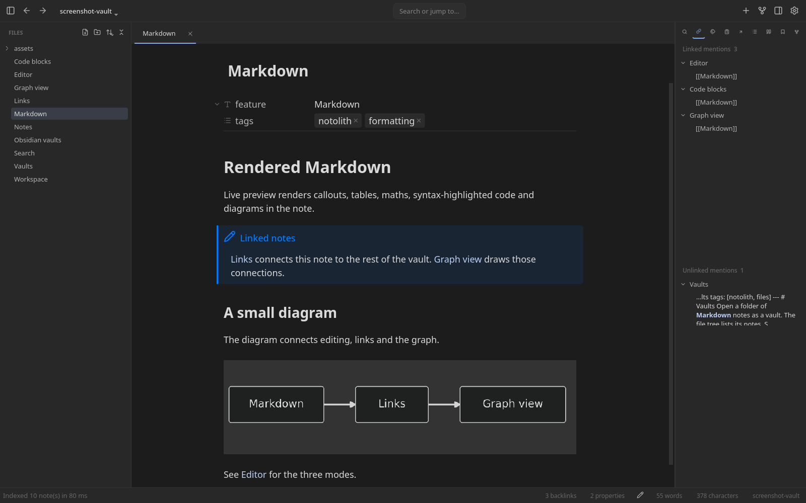
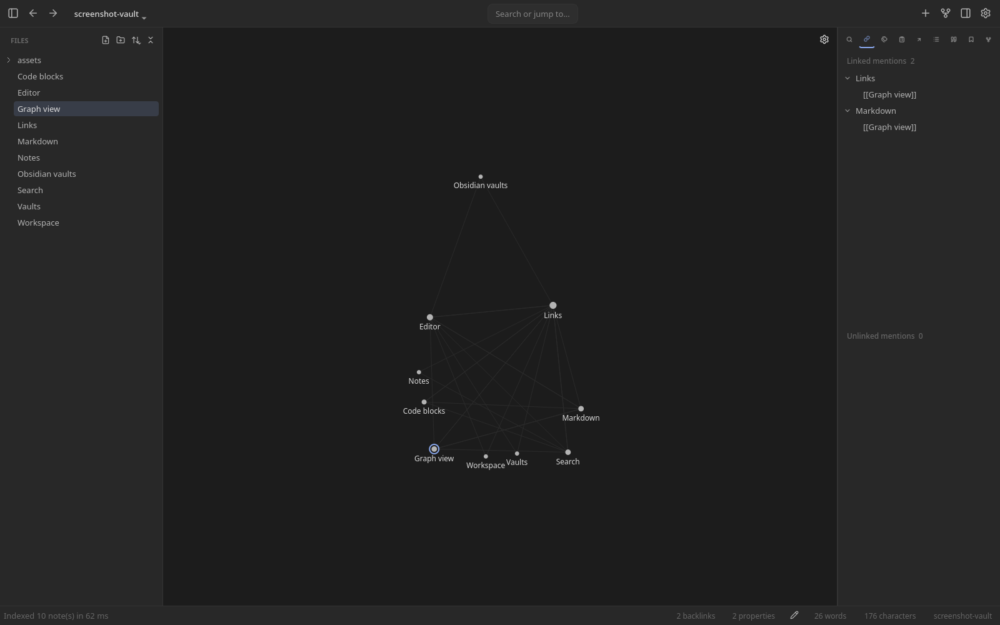

# Notolith

Public beta: expect bugs, and back up your vault.

A native Markdown editor with advanced features written in C++




## Install

Dependencies:

- Build: C++20 compiler, Qt 6.7+ Base and SVG, CMake 3.28+, Ninja, Git, Python 3, pkgconf and libseccomp.
- Code and diagrams: bubblewrap, util-linux (`prlimit`) and `mmdr`; tests: GoogleTest.

```sh
git clone https://github.com/jernejmarcic/Notolith
cd Notolith
cmake -B build -G Ninja -DCMAKE_BUILD_TYPE=Release -DBUILD_TESTING=OFF
cmake --build build
sudo cmake --install build
```

Update: `git pull && cmake --build build && sudo cmake --install build`.

Uninstall: `sudo xargs rm < build/install_manifest.txt`.

Tests: `cmake -B build-test -G Ninja && cmake --build build-test && QT_QPA_PLATFORM=offscreen ctest --test-dir build-test --output-on-failure`.

## Features

- **Editor:** Live preview, source and reading modes with editable properties.
- **Links:** Wikilinks, embeds, backlinks, outgoing links and local or global graph views.
- **Markdown:** Callouts, tables, maths, syntax-highlighted code and Mermaid diagrams.
- **Code blocks:** Run Python and other supported languages and view output below each block.
- **Search:** Search notes and use tags, an outline, bookmarks and a command palette.
- **Workspace:** Tabs, nested splits and saved layouts.
- **Notes:** Daily notes and templates.
- **Obsidian vaults:** Opens Obsidian vaults and reads theme colours, fonts, hotkeys, bookmarks, daily notes, templates, graph settings and workspaces from `.obsidian/`. Obsidian plugins are ignored.

See [docs/](docs/) and [THIRD-PARTY.md](THIRD-PARTY.md).
