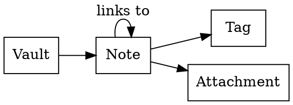
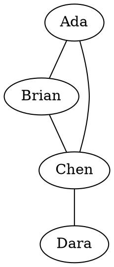
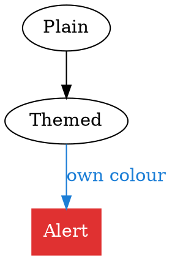
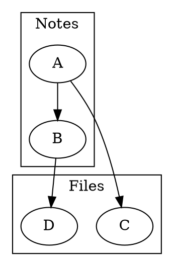

# Graphviz diagrams

What to look for: each ` ```dot ` and ` ```graphviz ` fence below (the two
names mean the same) should be drawn as its graph with `dot -Tsvg`, the
app's text colour and background applied as the graph's defaults so the
picture suits the theme. A graph's own attributes win over those defaults:
the one with an explicit colour keeps it. The tool runs inside bubblewrap's
sandbox (no network, no home directory), so a graph cannot pull in an image
file or an `import`. Without `dot` or `bwrap` a fence shows its source with
one dim line under it ("Graphviz: install dot to render"). Settings > Core
plugins > "Graphviz diagrams" turns it off, and then a fence is an ordinary
code block.

## A directed graph



## An undirected graph with the short name



## The graph's own colours win

The default colours come from the theme, but a node or edge that sets its own
keeps it: the red box and the blue edge here stay red and blue on any theme,
and the rest follows the theme:



## Clusters



## A graph with a syntax error

The brace is never closed. Expect the source in a listing and a dim line that
starts "Graphviz:" and carries dot's own first error line:

```dot
digraph Broken {
    A -> B
    B ->
```

## A source with no graph

Without a `{` the source is left alone and `dot` rejects it, the same error
state:

```dot
this is not a graph
```

## Theme

Switch the theme with this note open: every graph is drawn again with the new
text colour and background.
