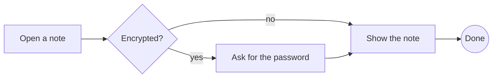
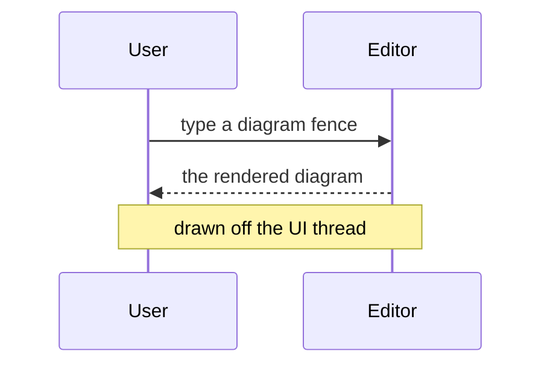
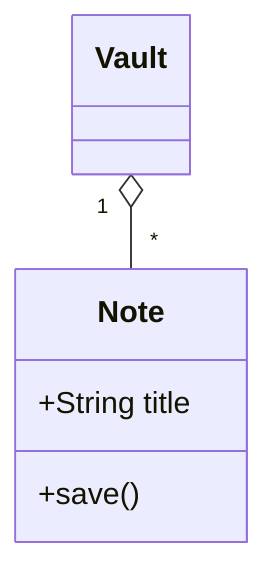
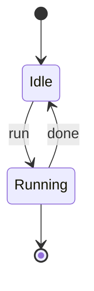
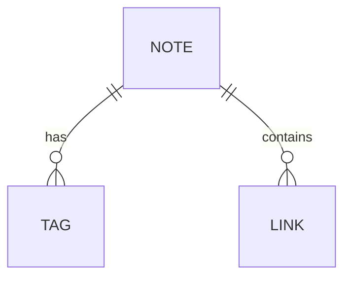
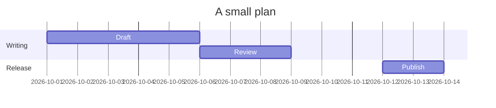
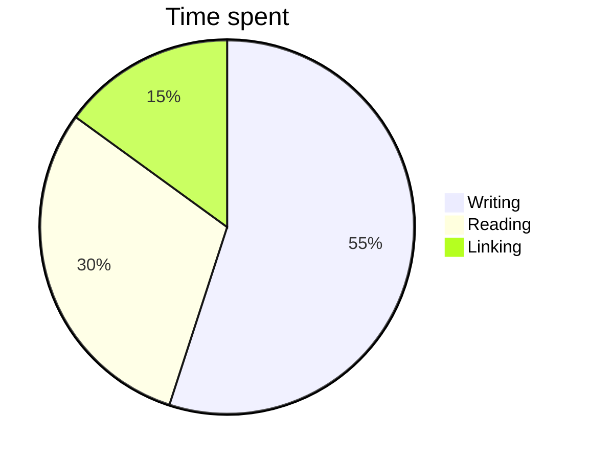

# Mermaid diagrams

What to look for: each ` ```mermaid ` fence below should be drawn as its
diagram - an image at the width of the text column, in the app's colours (a
dark theme gives a dark diagram, a light theme a light one) - and the drawing
should appear a moment after the note opens without freezing the window while
it does. The caret inside a fence shows its source instead, so it can be
edited, and drawing resumes when the caret leaves. The drawing is done by the
external program `mmdr` (the Rust `mermaid-rs-renderer`, installed with
`cargo install mermaid-rs-renderer`), which Notolith finds on `PATH` or in
`~/.cargo/bin` and `~/.local/share/cargo/bin`. Without it every fence shows
its source in a listing with one dim line under it: "Mermaid: install mmdr to
render". The switch is Settings > Core plugins > "Mermaid diagrams"; off, a
fence is an ordinary code block and nothing is ever started.

## Flowchart

Rounded, diamond and circle nodes, labelled edges, a left-to-right layout:



## Sequence diagram

Two participants with display names, a solid and a dashed message and a note
spanning both:



## Class diagram

A class with attributes and a method, and a one-to-many relation:



## State diagram



## Entity-relationship diagram



## Gantt chart



## Pie chart



## A diagram with a syntax error

The edge below has no target, which `mmdr` refuses. The fence should not
vanish and should not be an empty box: it shows its source in a listing, and
under it one dim italic line that starts with "Mermaid:" and carries the
tool's own message (`error: invalid flowchart edge syntax: A -->`):

```mermaid
flowchart LR
    A -->
```

## Not a diagram at all

The first line is not a diagram type. Same error state, a different message
(`error: unknown or missing Mermaid diagram header`):

```mermaid
this is not mermaid
```

## Editing one

Click into the flowchart's fence, or move the caret into it with the arrow
keys: the fence lines and the source appear. Type a change, move out: the
diagram is drawn again from the new source. A diagram drawn before is kept in
a cache, so reopening this note shows them all at once without starting
`mmdr` again.

## Where it does not draw

Not in an encrypted note (the source would go into the cache), and not on a
slide. Publish and PDF export never start `mmdr`: they use the picture the
editor already made, and a fence that was never on screen is exported as its
source.
