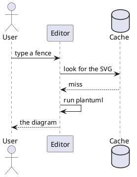
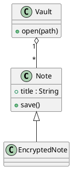
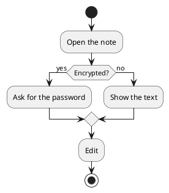

# PlantUML diagrams

What to look for: each ` ```plantuml ` and ` ```puml ` fence below (the two
names mean the same) should be drawn as its diagram, in the app's colours: on
a dark theme PlantUML is asked for its dark mode, on a light theme the usual
white page. The drawing is done by `plantuml` (and Java), which Notolith never
bundles, run inside bubblewrap's sandbox with no network, no home directory
and a 20 second limit; the first diagram of a session takes a moment (a
JVM starts), later ones are quick and a repeated one is read from the cache.
Without `plantuml` or `bwrap` a fence shows its source with one dim line under
it ("PlantUML: install plantuml to render"); there is never an unsandboxed run.
Settings > Core plugins > "PlantUML diagrams" turns it off, and then a fence
is an ordinary code block.

## Sequence diagram, with the start and end lines



## Sequence diagram, without them

A source with no `@start...` line is wrapped in `@startuml` ... `@enduml`
before it is run, so a bare fence works. This one uses the short name:

```puml
Alice -> Bob : hello
Bob --> Alice : hi
Alice -> Bob : how is the vault?
```

## Class diagram



## Activity diagram

A decision with two branches:



## A diagram with a syntax error

PlantUML answers a bad source with an error picture and exit code 200;
Notolith shows the source as a listing with the last line PlantUML printed
under it, here "PlantUML: Syntax Error? (Assumed diagram type: sequence)":

```plantuml
@startuml
Alice ->
class {{{
@enduml
```

## An include is refused

The run is in PlantUML's own SANDBOX security profile on top of the sandbox,
so `!include` of a file or a URL cannot read anything. Expect the source and a
dim line naming the failure instead of the file's contents:

```plantuml
@startuml
!include /etc/hostname
Alice -> Bob : never drawn
@enduml
```

## Theme

Switch the theme (Settings > Appearance) between light and dark with this note
open. Each diagram is drawn again for the new colours, the dark ones with
PlantUML's `--dark-mode`.
